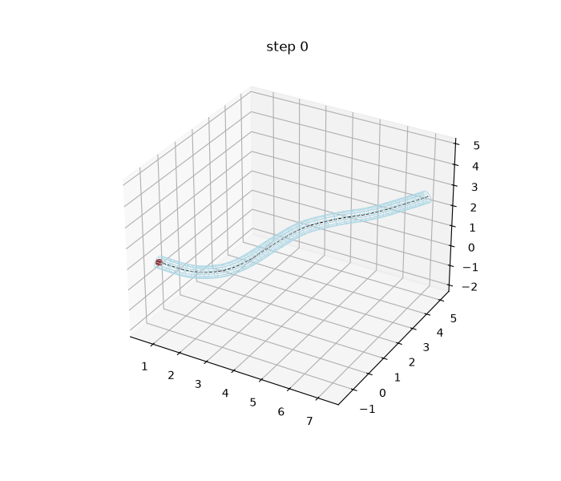
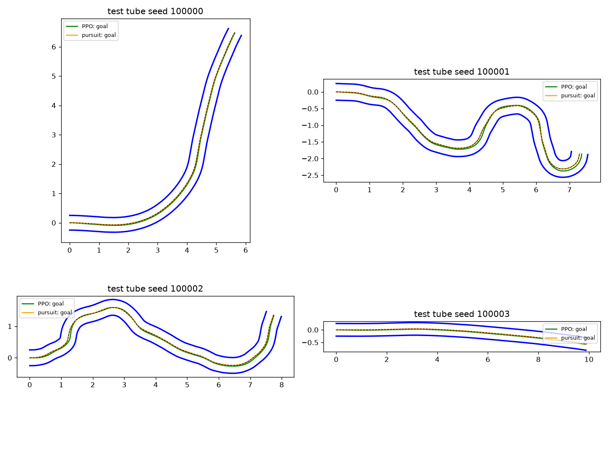
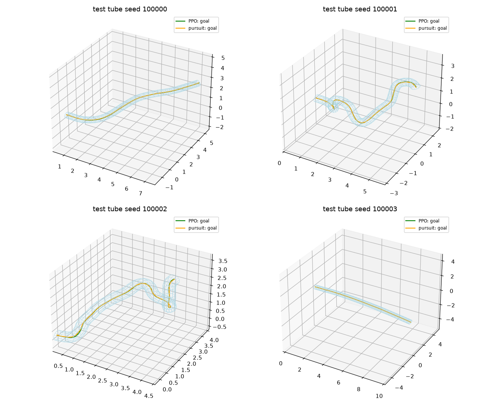

# Endoscope tip navigation in random curved tubes (RL)

A PPO agent steers an endoscope tip through random curved tubes
(a simplified colon model) without touching the wall, in 2D and in 3D.
Every episode uses a new random tube, so the agent cannot memorize one path.

| 2D | 3D |
|----|----|
|  |  |

## Task

The 2D and 3D versions use the same idea, the same reward and the same end conditions.

| | 2D | 3D |
|---|---|---|
| Tube | centerline + two walls | centerline + circular cross-section |
| Action | turn, in [-1, 1] (max 10° per step) | yaw and pitch, each in [-1, 1] (max 10° per step) |
| Tip orientation | heading angle | 3×3 rotation matrix |
| Observation | 12 numbers | 19 numbers |

- **Tube:** a random centerline with constant width (radius 0.25 in 3D).
  Curviness is sampled per episode, from straight to strongly curved.
  The turn rate is limited, so the inner wall never folds.
- **Observation:** everything is given in the tip's own frame
  (forward, left, and up in 3D), so the same bend looks the same anywhere in the tube.
  - offset from the centerline, normalized so the wall is at 1,
  - direction of the tube relative to the tip,
  - the next 5 centerline points.
- **3D frame:** the tube frame is carried along the centerline with parallel transport,
  so it does not twist on straight parts.
- **Reward:**
  - progress along the centerline (×10),
  - a small penalty for distance from the center,
  - −10 for hitting the wall,
  - +10 for reaching the end.
- **Episode end:** reaching the end or hitting the wall (terminated),
  or 400 steps (truncated).

## Training

PPO from Stable-Baselines3, on CPU. All runs use the same settings.

| Setting                | Value                     |
|------------------------|---------------------------|
| Policy / value network | MLP, 2 × 64 units each    |
| Parallel environments  | 8                         |
| Rollout                | 1024 steps per env (8192) |
| Batch size / epochs    | 256 / 10                  |
| γ / GAE λ              | 0.99 / 0.95               |
| Learning rate / clip   | 3e-4 / 0.2                |

Runs:

- `ppo_endoscope`: 2D, 50k steps (stops after the 7th rollout, at 57,344 steps).
- `ppo_300k`: 2D, 300k steps, about 1.2 minutes on a laptop CPU.
- `ppo3d_300k`: 3D, 300k steps, about 1.6 minutes on a laptop CPU.

### Learning curves

`rollout/ep_rew_mean` (mean return of the last 100 training episodes).
The maximum possible return is about 109.5.

**2D, 50k and 300k runs**


- 0–20k steps: the tip hits the wall almost at once.
- 20k–100k steps: most of the learning happens here.
- After 100k steps: the curve is flat at about 108.9.
- The 50k run stops in the middle of the rise. Its training curve ends at 95,
  but the deterministic policy already reaches the goal on every test tube (see below).
  Training actions are sampled from a Gaussian policy, so exploration noise
  causes some crashes during training.

**2D and 3D, 300k runs**


- 3D starts lower: a random tip hits the wall faster when it turns on two axes.
- 3D rises a little later, but both runs end at the same level
  (108.9 in 2D, 108.8 in 3D).

## Results

Evaluation on 300 test tubes (seeds 100000+), never seen in training.
PPO uses the deterministic policy (mean action).
For each run, the PPO model is the best checkpoint: the one with the highest
evaluation score during training (`best_model.zip`).

**2D**

| Policy                   | Goal   | Crash  | Mean return     | Mean length |
|--------------------------|--------|--------|-----------------|-------------|
| PPO, 50k steps           | 100 %  | 0 %    | 109.10 ± 0.17   | 199.7       |
| PPO, 300k steps          | 100 %  | 0 %    | 109.22 ± 0.14   | 198.5       |
| Pursuit (hand-made)      | 100 %  | 0 %    | 109.09 ± 0.07   | 198.0       |
| Straight (never turns)*  | 1.7 %  | 98.3 % | 8.13 ± 17.68    | 38.7        |
| Random*                  | 0 %    | 100 %  | 0.99 ± 6.54     | 25.1        |

**3D**

| Policy                   | Goal   | Crash  | Mean return     | Mean length |
|--------------------------|--------|--------|-----------------|-------------|
| PPO, 300k steps          | 100 %  | 0 %    | 109.17 ± 0.15   | 199.1       |
| Pursuit (hand-made)      | 100 %  | 0 %    | 109.12 ± 0.08   | 198.0       |
| Straight (never turns)*  | 1.0 %  | 99.0 % | 2.98 ± 14.10    | 28.7        |
| Random*                  | 0 %    | 100 %  | −2.60 ± 3.74    | 17.8        |

\* Baselines from `check_env.py`, on 300 tubes with seeds 0–299.

**Pursuit** is a hand-made controller, not RL. It turns the tip toward
the 2nd centerline point ahead. It shows that the task is solvable
and gives a strong reference for PPO.

### Paths on test tubes (PPO in green, pursuit in orange)

**2D**

| PPO, 50k steps | PPO, 300k steps |
|----------------|-----------------|
|  |  |

**3D**




## Discussion

- PPO matches the hand-made pursuit controller on unseen tubes, in 2D and in 3D.
  With a perfect centerline observation, the task is easy enough
  for a simple geometric controller.
- These stages check the full pipeline: tube generator, environment,
  baselines, training and evaluation.
- RL becomes useful where a hand-made controller is hard to write:
  a camera image as the observation, variable speed, or physical
  contact between a bendable endoscope and the wall.

## Files

- `tube.py`, `tube3d.py`: random curved tubes and geometry queries
  (offset, progress, points ahead)
- `endoscope_env.py`, `endoscope_env3d.py`: Gymnasium environments
- `check_env.py`: Gymnasium API check and baseline policies
- `train.py`: PPO training (Stable-Baselines3, CPU), TensorBoard logs
- `evaluate.py`: test on unseen tubes, path plots, GIF

`check_env.py`, `train.py` and `evaluate.py` take `--dim 2` (default) or `--dim 3`.

## Setup

Python 3.11, [uv](https://github.com/astral-sh/uv):

```
uv sync
```

## Usage

2D:

```
uv run python tube.py
uv run python check_env.py
uv run python train.py --steps 300000 --name ppo_300k
uv run python evaluate.py --model models/ppo_300k/best_model.zip --out results_300k
```

3D:

```
uv run python tube3d.py
uv run python check_env.py --dim 3
uv run python train.py --dim 3 --steps 300000 --name ppo3d_300k
uv run python evaluate.py --dim 3 --model models/ppo3d_300k/best_model.zip --out results3d_300k
```

Learning curves:

```
uv run tensorboard --logdir runs
```

## Next steps

- Harder test: tubes more curved than in training
- MuJoCo: real wall geometry, bendable endoscope, physical contact
- Camera image as the observation (CNN)