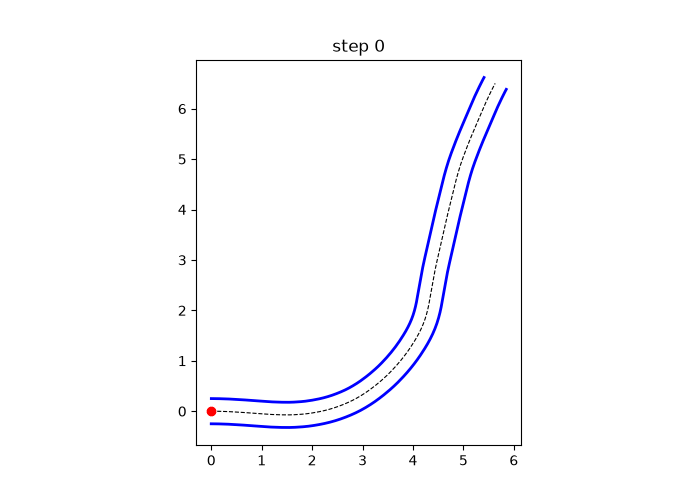
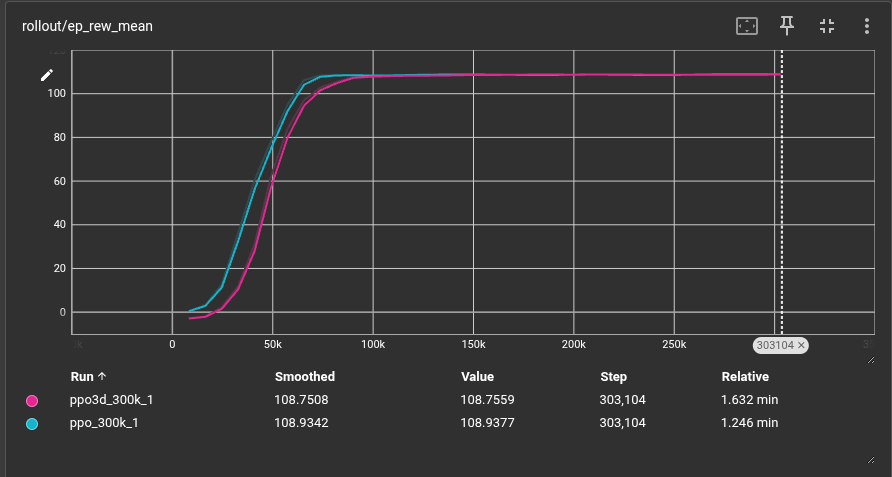
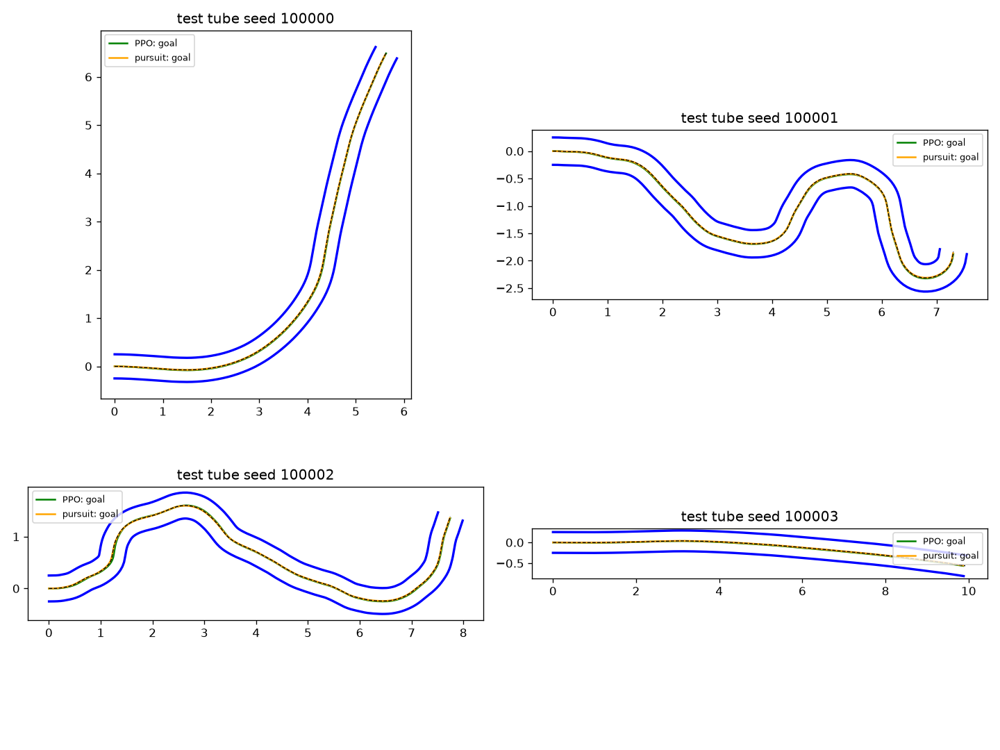
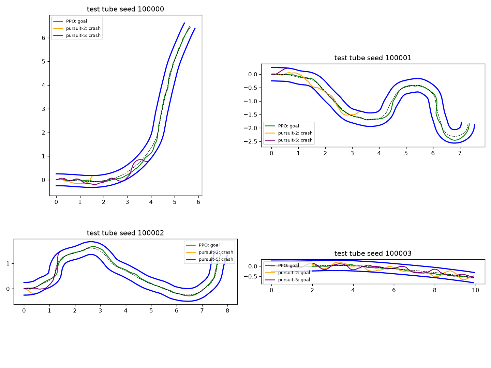
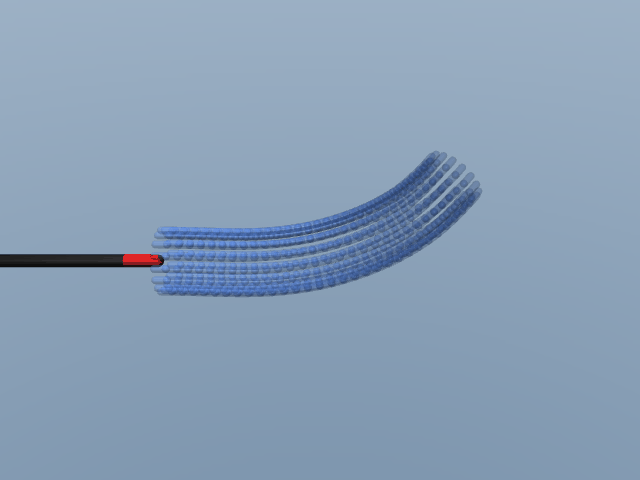
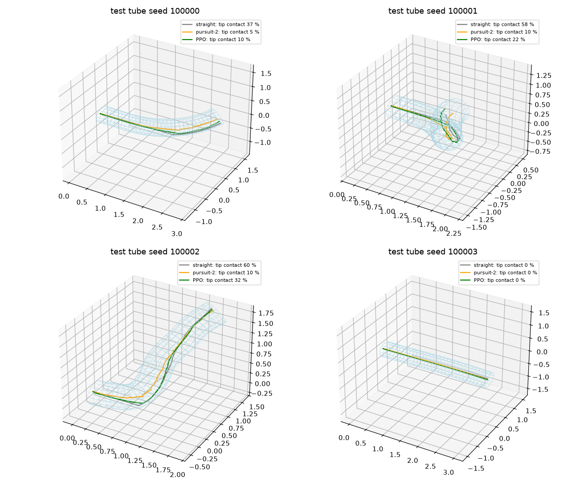

# Endoscope tip navigation in random curved tubes (RL)

A PPO agent steers an endoscope tip through random curved tubes
(a simplified colon model) without touching the wall, in 2D and in 3D.
A first physics-based version in MuJoCo uses a bendable endoscope with wall contact.
Every episode uses a new random tube, so the agent cannot memorize one path.

| 2D | 3D |
|----|----|
|  |  |

## Task

The 2D and 3D versions use the same idea, the same reward and the same end conditions.

| | 2D | 3D |
|---|---|---|
| Tube | centerline + two walls | centerline + circular cross-section |
| Action | turn, in [-1, 1] (max 10° per step) | yaw and pitch, each in [-1, 1] (max 10° per step) |
| Tip orientation | heading angle | 3×3 rotation matrix |
| Observation | 12 numbers | 19 numbers |

- **Tube:** a random centerline with constant width (radius 0.25 in 3D).
  Curviness is sampled per episode, from straight to strongly curved.
  The turn rate is limited, so the inner wall never folds.
- **Observation:** everything is given in the tip's own frame
  (forward, left, and up in 3D), so the same bend looks the same anywhere in the tube.
  - offset from the centerline, normalized so the wall is at 1,
  - direction of the tube relative to the tip,
  - the next 5 centerline points.
- **3D frame:** the tube frame is carried along the centerline with parallel transport,
  so it does not twist on straight parts.
- **Reward:**
  - progress along the centerline (×10),
  - a small penalty for distance from the center,
  - −10 for hitting the wall,
  - +10 for reaching the end.
- **Episode end:** reaching the end or hitting the wall (terminated),
  or 400 steps (truncated).

## Training

PPO from Stable-Baselines3, on CPU. All runs use the same settings.

| Setting                | Value                     |
|------------------------|---------------------------|
| Policy / value network | MLP, 2 × 64 units each    |
| Parallel environments  | 8                         |
| Rollout                | 1024 steps per env (8192) |
| Batch size / epochs    | 256 / 10                  |
| γ / GAE λ              | 0.99 / 0.95               |
| Learning rate / clip   | 3e-4 / 0.2                |

Runs:

- `ppo_endoscope`: 2D, 50k steps (stops after the 7th rollout, at 57,344 steps).
- `ppo_300k`: 2D, 300k steps, about 1.2 minutes on a laptop CPU.
- `ppo3d_300k`: 3D, 300k steps, about 1.6 minutes on a laptop CPU.

### Learning curves

`rollout/ep_rew_mean` (mean return of the last 100 training episodes).
The maximum possible return is about 109.5.

**2D, 50k and 300k runs**


- 0–20k steps: the tip hits the wall almost at once.
- 20k–100k steps: most of the learning happens here.
- After 100k steps: the curve is flat at about 108.9.
- The 50k run stops in the middle of the rise. Its training curve ends at 95,
  but the deterministic policy already reaches the goal on every test tube (see below).
  Training actions are sampled from a Gaussian policy, so exploration noise
  causes some crashes during training.

**2D and 3D, 300k runs**



- 3D starts lower: a random tip hits the wall faster when it turns on two axes.
- 3D rises a little later, but both runs end at the same level
  (108.9 in 2D, 108.8 in 3D).

## Results

Evaluation on 300 test tubes (seeds 100000+), never seen in training.
PPO uses the deterministic policy (mean action).
For each run, the PPO model is the best checkpoint: the one with the highest
evaluation score during training (`best_model.zip`).

**2D**

| Policy                   | Goal   | Crash  | Mean return     | Mean length |
|--------------------------|--------|--------|-----------------|-------------|
| PPO, 50k steps           | 100 %  | 0 %    | 109.10 ± 0.17   | 199.7       |
| PPO, 300k steps          | 100 %  | 0 %    | 109.22 ± 0.14   | 198.5       |
| Pursuit (hand-made)      | 100 %  | 0 %    | 109.09 ± 0.07   | 198.0       |
| Straight (never turns)*  | 1.7 %  | 98.3 % | 8.13 ± 17.68    | 38.7        |
| Random*                  | 0 %    | 100 %  | 0.99 ± 6.54     | 25.1        |

**3D**

| Policy                   | Goal   | Crash  | Mean return     | Mean length |
|--------------------------|--------|--------|-----------------|-------------|
| PPO, 300k steps          | 100 %  | 0 %    | 109.17 ± 0.15   | 199.1       |
| Pursuit (hand-made)      | 100 %  | 0 %    | 109.12 ± 0.08   | 198.0       |
| Straight (never turns)*  | 1.0 %  | 99.0 % | 2.98 ± 14.10    | 28.7        |
| Random*                  | 0 %    | 100 %  | −2.60 ± 3.74    | 17.8        |

\* Baselines from `check_env.py`, on 300 tubes with seeds 0–299.

**Pursuit** is a hand-made controller, not RL. It turns the tip toward
the 2nd centerline point ahead. It shows that the task is solvable
and gives a strong reference for PPO.

### Paths on test tubes (PPO in green, pursuit in orange)

**2D**

| PPO, 50k steps | PPO, 300k steps |
|----------------|-----------------|
|  |  |

**3D**


## Robustness test

The trained 300k models are tested, **without retraining**, in conditions
they never saw in training (`hard_test.py`, 300 test tubes per condition).

Training: curviness c in [0, 0.08], width 0.5, tip turn up to 10° per step,
exact observations.

| Condition  | What changes |
|------------|--------------|
| train      | nothing (reference) |
| sharp tube | c in [0.08, 0.16], width 0.30. Some bends are sharper than the tip can turn (up to about 13° per step). |
| weak tip   | c in [0.08, 0.16], tip turn only up to 6° per step |
| noise s    | Gaussian noise with standard deviation s added to every observation number |

Two hand-made baselines:

- **pursuit-2** aims at the 2nd point ahead (0.10 ahead). This is the pursuit policy above.
- **pursuit-5** aims at the 5th point ahead (0.25 ahead). Looking farther ahead
  averages out more noise, so it is a stronger baseline.

**Goal rate (%)**

| Condition   | 2D PPO | 2D pursuit-2 | 2D pursuit-5 | 3D PPO | 3D pursuit-2 | 3D pursuit-5 |
|-------------|--------|--------------|--------------|--------|--------------|--------------|
| train       | 100    | 100          | 100          | 100    | 100          | 100          |
| sharp tube  | 97.3   | 98.3         | **99.7**     | 100    | 100          | 100          |
| weak tip    | 84.7   | 78.3         | **96.7**     | 100    | 99.7         | 100          |
| noise 0.1   | **100**| 67.3         | **100**      | **100**| 46.0         | **100**      |
| noise 0.2   | **100**| 1.3          | 68.7         | **100**| 0.7          | 50.3         |
| noise 0.3   | **99.0**| 0.0         | 12.0         | **100**| 0.0          | 1.0          |

`hard_test.py` also prints the crash rate, progress and return,
and writes the full tables to `results_hard/`.

**Paths with observation noise s = 0.2 (2D):** PPO in green, pursuit-2 in orange, pursuit-5 in purple.



**Findings**

- **Observation noise:** PPO was never trained with noise, but it reaches the goal
  in at least 99 % of the tubes up to s = 0.3. Both pursuit controllers fail.
  Pursuit uses one point, so the noise on that point goes straight into the action.
  The PPO policy uses all 12 (2D) or 19 (3D) numbers. These numbers carry
  the same information several times, so the effect of the noise becomes smaller.
- **Weak tip (2D):** pursuit-5 is better than PPO. PPO was trained with a tip
  that turns 10° per step, so it starts turning too late when the tip is weaker.
  Looking farther ahead starts the turn earlier.
- **3D is easier in these two conditions:** the turn is split over two axes.
  With 6° per axis, the combined turn is up to about 8.5° per step,
  and the bends of the tube are also split over two axes.

**Limits of this test**

- The noise model is simple: the same std, independent for every number and every step.
  A real sensor does not behave like this.
- A hand-made controller with a filter (for example a Kalman filter on the
  centerline points) could also be robust to noise. The point here is that
  PPO learned to combine its inputs without being told how.

## MuJoCo version (first results)

The 2D/3D versions move the tip with a formula. This version simulates
a bendable endoscope with physical wall contact in [MuJoCo](https://mujoco.org).



**Model** (`mujoco_model.py`)

- **Tube:** a random 3D tube (length 3, radius 0.25). The wall is a cage of
  480 small capsules, because MuJoCo cannot collide with a hollow tube as one shape.
- **Endoscope:** a chain of 34 capsule links. Each link joins the previous one
  with two hinge joints (yaw, pitch).
  - Body joints are passive, with a spring and damping. The body slides along the wall.
  - The last 3 links (red) form the bending section, driven by position actuators.
  - The base is pushed at constant speed (insertion), as in a real endoscope.
- Gravity is off: the endoscope floats in the lumen.

**Task** (`endoscope_mujoco_env.py`)

- **Action:** yaw and pitch target of the bending section, each in [-1, 1] (max 0.5 rad per joint).
- **Observation (23 numbers):** the 19 numbers of the 3D version (tip frame),
  the bending angles (2), and the tip and body contact forces (2).
- **Reward:** progress, a strong penalty for the tip contact force,
  a weak penalty for the body contact force, and a small penalty for distance from the center.
- Touching the wall does not end the episode. The episode ends at the end of the tube
  or after 250 steps.

Why the reward focuses on the tip: even without any bending, the pushed endoscope
slides along the wall and reaches the end. Most of the contact force comes from the body,
and steering the tip hardly changes it. The tip contact force is what steering can change,
and the tip is where a real endoscope can perforate the wall.

**Results** (PPO 300k steps, best checkpoint, 100 test tubes; all policies reach the end)

| Policy     | Tip contact (% of steps) | Tip mean force | Tip max force | Body mean force | Return |
|------------|--------------------------|----------------|---------------|-----------------|--------|
| Straight   | 44.6 %                   | 0.260          | 2.67          | 0.426           | −39.67 |
| Pursuit-2  | **6.8 %**                | **0.198**      | 5.71          | 0.432           | **−19.86** |
| Pursuit-5  | 9.2 %                    | 0.205          | 5.23          | 0.439           | −22.89 |
| PPO        | 15.1 %                   | 0.222          | **3.22**      | 0.444           | −28.86 |

Pursuit here adds the angle to the target point to the current bending angle,
because the action sets the bending relative to the body.



**Findings**

- PPO learns to steer: tip contact drops from 44.6 % (no bending) to 15.1 %.
  After 100k steps it was about 23 %, so longer training still helps.
- Pursuit is better on tip contact, mean tip force and return.
- The two policies touch the wall in different ways. Pursuit touches rarely but hard
  (about 2.9 mean force per contact step); PPO touches more often but softly (about 1.5).
  PPO also has a lower peak force, which matters for perforation risk.
- The body contact force is the same for every policy (about 0.43):
  steering the tip does not change how the pushed body touches the wall.

**Limits**

- Rigid wall, simple bending model (no tendons), no gravity, and arbitrary units.
- One training run (300k steps, one seed).

## Discussion

- PPO matches the hand-made pursuit controller on unseen tubes, in 2D and in 3D.
  With a perfect centerline observation, the task is easy enough
  for a simple geometric controller.
- With noisy observations, PPO is clearly more robust than pursuit.
  With a weaker tip than in training, a pursuit controller that looks farther ahead
  is better than PPO.
- These stages check the full pipeline: tube generator, environment,
  baselines, training, evaluation and robustness testing.
- In the MuJoCo version with physical contact, PPO learns to reduce tip contact,
  but the hand-made pursuit rule is still better after 300k steps.
  PPO touches the wall more often but with lower peak force.
- RL becomes useful where a hand-made controller is hard to write:
  a camera image as the observation, variable speed, or complex
  contact between a bendable endoscope and a soft wall.

## Files

- `tube.py`, `tube3d.py`: random curved tubes and geometry queries
  (offset, progress, points ahead)
- `endoscope_env.py`, `endoscope_env3d.py`: Gymnasium environments
- `check_env.py`: Gymnasium API check and baseline policies
- `train.py`: PPO training (Stable-Baselines3, CPU), TensorBoard logs
- `evaluate.py`: test on unseen tubes, path plots, GIF
- `hard_test.py`: robustness test (sharp tubes, weak tip, observation noise)
- `mujoco_model.py`: builds the MuJoCo model (tube wall cage, endoscope chain)
- `endoscope_mujoco_env.py`: Gymnasium environment with MuJoCo physics, pursuit and straight baselines
- `train_mujoco.py`, `evaluate_mujoco.py`: PPO training (parallel processes) and evaluation
- `watch_mujoco.py`: watch a policy live in the MuJoCo viewer

`check_env.py`, `train.py` and `evaluate.py` take `--dim 2` (default) or `--dim 3`.

## Setup

Python 3.11, [uv](https://github.com/astral-sh/uv):

```
uv sync
```

## Usage

2D:

```
uv run python tube.py
uv run python check_env.py
uv run python train.py --steps 300000 --name ppo_300k
uv run python evaluate.py --model models/ppo_300k/best_model.zip --out results_300k
```

3D:

```
uv run python tube3d.py
uv run python check_env.py --dim 3
uv run python train.py --dim 3 --steps 300000 --name ppo3d_300k
uv run python evaluate.py --dim 3 --model models/ppo3d_300k/best_model.zip --out results3d_300k
```

MuJoCo:

```
uv run python mujoco_model.py --view                      # physics only, straight push
uv run python train_mujoco.py --steps 300000 --name ppo_mujoco_300k
uv run python evaluate_mujoco.py --model models/ppo_mujoco_300k/best_model.zip --out results_mujoco_300k
uv run python watch_mujoco.py --model models/ppo_mujoco_300k/best_model.zip
```

Robustness test (needs both 300k models):

```
uv run python hard_test.py
```

Learning curves:

```
uv run tensorboard --logdir runs
```

## Next steps

- MuJoCo: residual RL (PPO learns a correction on top of pursuit), longer training, more seeds
- MuJoCo: soft wall, tendon-driven bending section
- Kalman filter baseline: a hand-made controller with filtered observations
- Train with observation noise and a range of tip turn limits
- Camera image as the observation (CNN)
